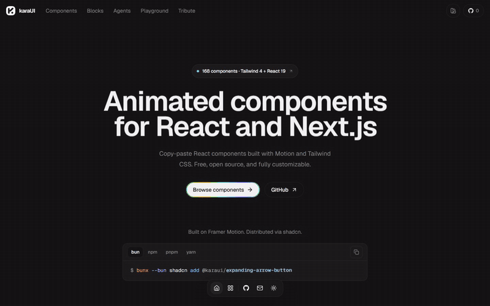

<p align="center">
  <a href="https://karaui.kamisama-v0.my.id">
    
  </a>
</p>

<h1 align="center">karaUI v2</h1>

<p align="center">
  Animated components for React and Next.js. Copy the source, own the code.
</p>

<p align="center">
  <a href="https://github.com/kamisama-v0/Karaui/blob/main/LICENSE"></a>
  <a href="https://github.com/kamisama-v0/Karaui/stargazers"></a>
  <a href="https://ui.shadcn.com/docs/registry"></a>
</p>

<p align="center">
  <a href="https://karaui.kamisama-v0.my.id">Website</a>
  ·
  <a href="https://karaui.kamisama-v0.my.id/components/motion">Components</a>
  ·
  <a href="https://karaui.kamisama-v0.my.id/llms.txt">llms.txt</a>
</p>

<p align="center">
  <a href="https://karaui.kamisama-v0.my.id"></a>
</p>

## What is karaUI?

karaUI is a small component library for product interfaces.

Each component includes a live preview, usage example, source code, and a shadcn install command. The components are meant to live in your app, not behind a package.

## Install a component

Open any component page and copy the install command. karaUI is in the shadcn registry directory under the `@karaui` namespace.

```bash
npx shadcn@latest add @karaui/animated-toast-stack
```

Direct URLs also work:

```bash
npx shadcn@latest add https://karaui.kamisama-v0.my.id/r/animated-toast-stack.json
```

You can also copy the source directly from the component page.

## For AI agents

karaUI exposes static endpoints that coding agents can read without scraping the UI.

```txt
https://karaui.kamisama-v0.my.id/llms.txt
https://karaui.kamisama-v0.my.id/r
https://karaui.kamisama-v0.my.id/r/{slug}
https://karaui.kamisama-v0.my.id/r/{slug}.json
https://karaui.kamisama-v0.my.id/r/{slug}/raw
```

Install the karaUI skill so Cursor, Claude Code and Codex pick existing `@karaui`
components before inventing new motion UI:

```bash
npx skills add kamisama-v0/Karaui --skill karaui
```

## Run locally

```bash
bun install
bun run dev
```

Open [http://localhost:3000](http://localhost:3000).

## Checks

```bash
bun run check
```

This runs TypeScript, Biome lint, and registry source validation.

## Contributing

Add components in `components/motion/`, previews in `components/previews/motion/`, and registry entries in `lib/registry.ts`.

Read [CONTRIBUTING.md](./CONTRIBUTING.md) before opening a PR.

## Star history

<a href="https://star-history.dera.page/#kamisama-v0/Karaui&Date">
  <picture>
    <source media="(prefers-color-scheme: dark)" srcset="https://star-history.dera.page/svg?repos=kamisama-v0/Karaui&type=Date&theme=dark" />
    <source media="(prefers-color-scheme: light)" srcset="https://star-history.dera.page/svg?repos=kamisama-v0/Karaui&type=Date" />
    
  </picture>
</a>

## Attribution & Tribute

**karaUI** is built upon and inspired by **[beUI](https://github.com/starc007/beui)**, originally created by [Saurabh Chauhan](https://x.com/saurra3h) ([@starc007](https://github.com/starc007)).

We express our highest tribute and sincere gratitude to **beUI** as our base project for its beautifully crafted motion components, design architecture, and generous open-source foundation.

## Credits

- **karaUI Maintainer**: kamisama-v0 · [kamisama-v0.my.id](https://kamisama-v0.my.id)
- **Base Project (beUI)**: Saurabh Chauhan · [@saurra3h](https://x.com/saurra3h) · [beUI on GitHub](https://github.com/starc007/beui)
